# SMPIS School Starter Guide

Edition 1 · October 2026

## 1. Your first sign-in

School portal → Sign in

Your school workspace starts with your own administrator account. Keep the school portal link from your registration email: this is the same link you will share with teachers and parents.

1. Open the verification email received after signup and verify your email address. Check Spam or use Resend verification email if needed.
2. Open your school portal and sign in using the email and password you registered with.
3. If asked to finish administrator security setup, add SMPIS to an authenticator app, enter the six-digit code, and keep the recovery codes somewhere safe.
4. Bookmark the school portal. Parents use this same school login page; their Parent role gives them a different menu after sign-in.

Ready when: you can open Administration. If verification email does not arrive, contact SMPIS support before creating another school account.

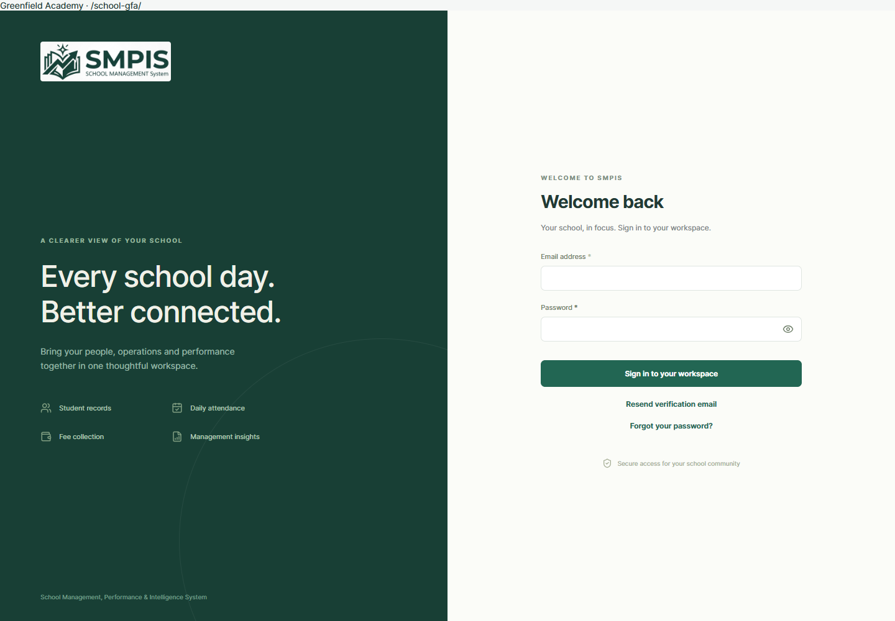

## 2. Check the school foundations

Administration → School

A few minutes here prevent confusing fee amounts and dates later. Greenfield Academy is our fictional example school throughout this guide.

1. Check the school name, currency and timezone. For a Nigerian school, examples are NGN and Africa/Lagos.
2. Check the attendance threshold, staff start time and attendance cutoff against your school policy.
3. Save changes. Confirm the currency before adding fees and payment methods.

Have ready: your class list, calendar dates, fee schedule, teacher emails, learner records and school bank details. Start with one class and one family, then repeat the flow.

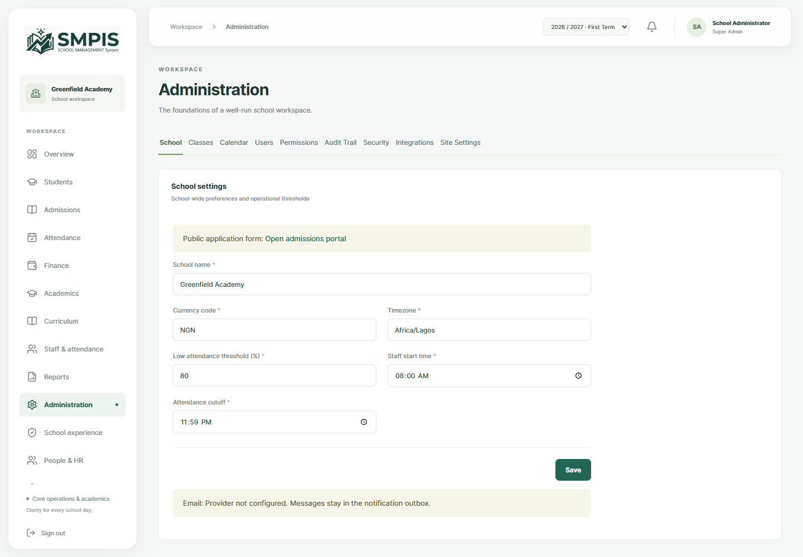

## 3. Put the calendar in place

Administration → Calendar

Classes belong to an academic year. Fees and invoices belong to a term. The term selector at the top of the workspace controls the term you are working with.

1. Review the academic year and term created during registration. Use New year or New term for any additional periods you need.
2. Enter the correct names and start/end dates. Associate each term with the intended academic year.
3. When creating the active term, select Make this the current term. If editing an existing term, use the current-term control in the term list.
4. Select the intended term in the top bar before configuring fees or generating invoices.

Example: 2026 / 2027 academic year, First Term. Use your own dates. Ready when: the top bar shows the term you intend to bill.

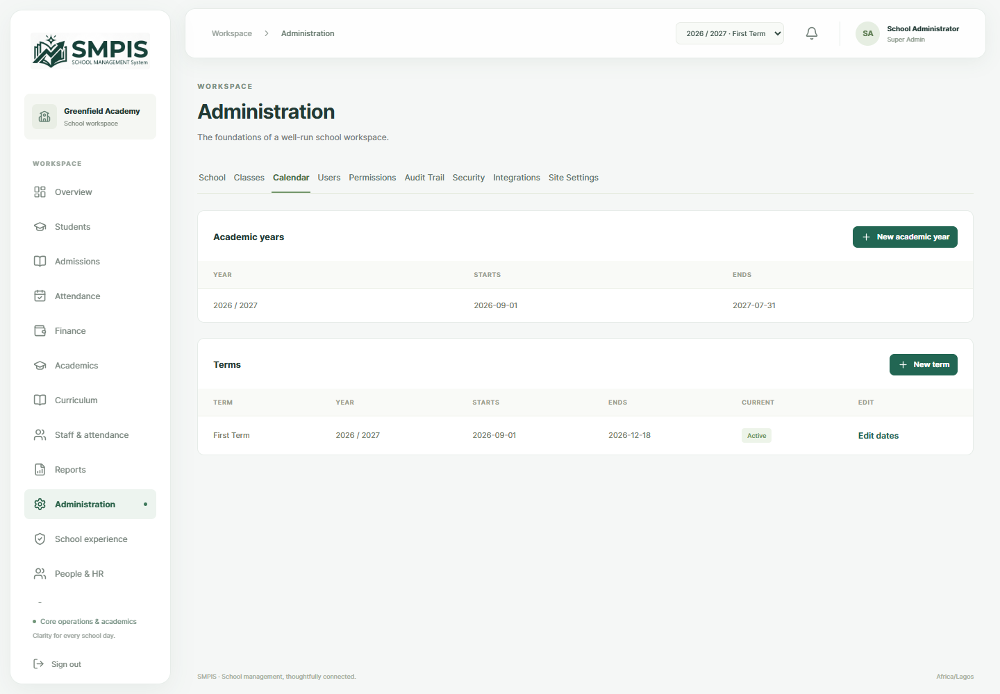

## 4. Create the classes you actually run

Administration → Classes → New class

Use names your teachers and families recognise: Nursery 1, Primary 3, JSS 1A or SS 2 Science. Create separate classes for separate streams.

1. Enter the Class name and Capacity. Capacity is the maximum enrollment for that class.
2. Choose the correct Academic year.
3. You may leave Class teacher blank until the teacher account exists. Save the class.
4. Repeat for every available class. Check the year and capacity in the class list.

Ready when: each class appears in the list. Avoid creating duplicate classes simply to change the teacher; use Edit class.

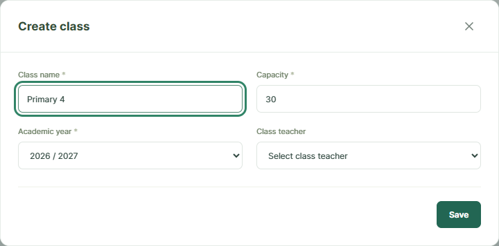

## 5. Give teachers their own accounts

Administration → Users → Create account

A teacher needs a user account to sign in. A staff employment record serves a separate purpose; it does not automatically create login access.

1. Enter the teacher’s Full name and unique Email address.
2. Set an Initial password of at least 12 characters and choose the Teacher role. Save.
3. Read the delivery message: account creation can succeed even if the account email fails. Resolve the delivery issue before assuming the teacher has received credentials.
4. Repeat for other teachers. Use the appropriate role for finance and other staff instead of sharing the administrator login.

The account email includes the portal link and credentials when email delivery is configured. Ask users to choose their own password with Forgot your password and enable two-step verification under Administration → Security.

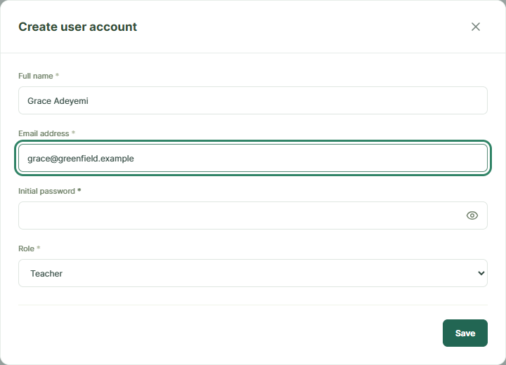

## 6. Assign a teacher to a class

Administration → Classes → Edit class

Creating a teacher account and assigning a class are two separate actions. The class assignment determines which learners a teacher can work with.

1. Find the class and click Edit class.
2. Choose the teacher in Class teacher. Check the academic year and capacity, then save.
3. Confirm the Class teacher column now shows the intended teacher. Repeat for other classes.
4. If you also need an employment record, add it under Staff & attendance and associate it with the teacher’s user account where offered.

Ready when: the teacher can sign in using their own account and see the assigned class. Academic subjects and teaching allocations can be configured next for results workflows.

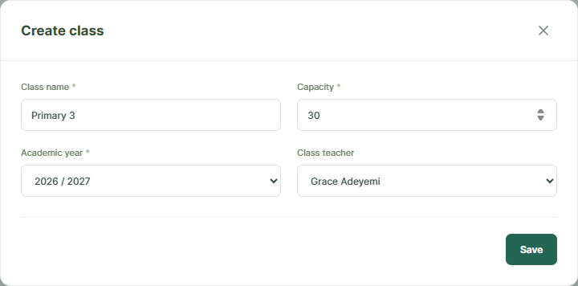

## 7. Set class fees for the term

Finance → Fee Structures → Set fee

A fee structure is your price list. An invoice is the individual bill created from that price list. Adding a fee does not automatically send a bill to every learner.

1. Select the correct academic term in the top bar.
2. Click Set fee, select Class and Fee category, and enter the amount in the displayed school currency. Save.
3. Add each applicable category: tuition, boarding, transport, exam, books, uniform, meals, activity or other.
4. Repeat for other classes and terms. Review the saved fee list before generating invoices.

Example: Primary 3 tuition = NGN 120,000 for First Term. Existing invoices retain their original charges when fee structures change. Review concessions and transport/boarding eligibility before billing.

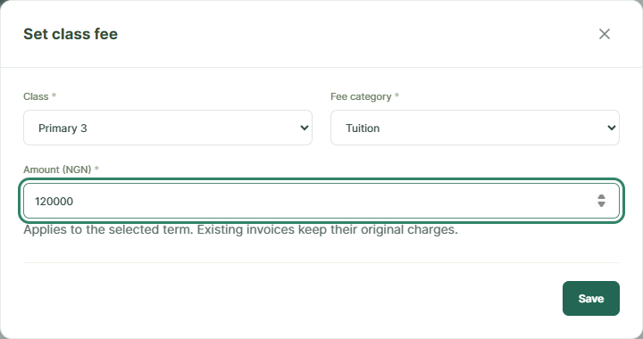

## 8. Offer school bank transfer

Administration → Integrations → Manual fee payments

Manual bank transfer is a practical first payment method. Parents see the school’s bank details, make the transfer, and submit its reference. Finance then checks receipt of funds.

1. Sign in as the school’s Super Admin and open Integrations.
2. Enable Manual fee payments and enter Bank name, Account name, Account number and Transfer instructions.
3. Use clear instructions such as “Include student name and invoice number in the narration.” Save.
4. Confirm the account details carefully. The account shown in this screenshot is fictional and must not be used for payment.

Ready when: Manual bank transfer appears in the parent’s School payment method list. A parent submission remains pending until school finance confirms the funds.

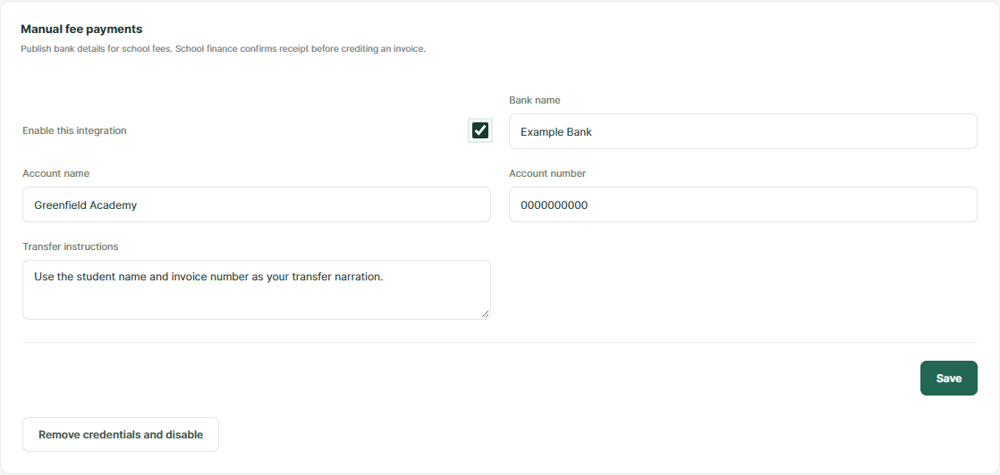

## 9. Enable an online payment gateway

Administration → Integrations → Your provider

The portal includes Paystack, Flutterwave, Stripe and PayPal settings. Choose a provider that supports your school’s country and currency, using your school’s merchant account.

1. Obtain the credentials from your provider’s dashboard. Enter the fields shown in its integration panel and enable the integration.
2. Save test credentials first and run a test checkout. Test-confirmed transactions do not reduce real invoice balances.
3. For real collection, save live credentials and select Allow live payments. Paystack also requires the application to have an HTTPS URL.
4. Confirm that your provider is available in the parent payment form. If it is missing, check credentials, currency and live availability with support.

Use provider documentation or support for merchant verification and any required callback/webhook setup. Share portal login details with parents; gateway secret keys stay in the administrator settings.

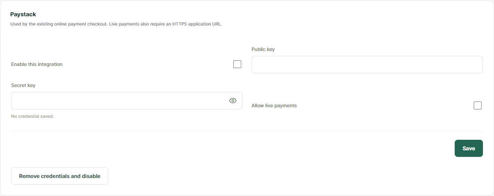

## 10. Make account emails useful

Administration → Integrations → SMTP email

Teachers and parents should receive a clear invitation instead of having to ask you for every login detail. Account emails include the school, role, email username, initial password, portal link and security guidance.

1. If your school uses its own email service, enter its SMTP hostname, port, username, password and sender email. Enable and save.
2. Use the TLS option exactly as your email provider instructs; the panel identifies immediate TLS as usually port 465.
3. If school SMTP is not configured, account emails can use the platform email service when it is configured.
4. Check the delivery result after creating an account, and test password reset with a demo user. Ask support to check the public portal URL or platform mail setup if links or delivery fail.

Ready when: a demo user receives working portal and reset links. This guide explains email delivery; it does not configure SMS delivery.

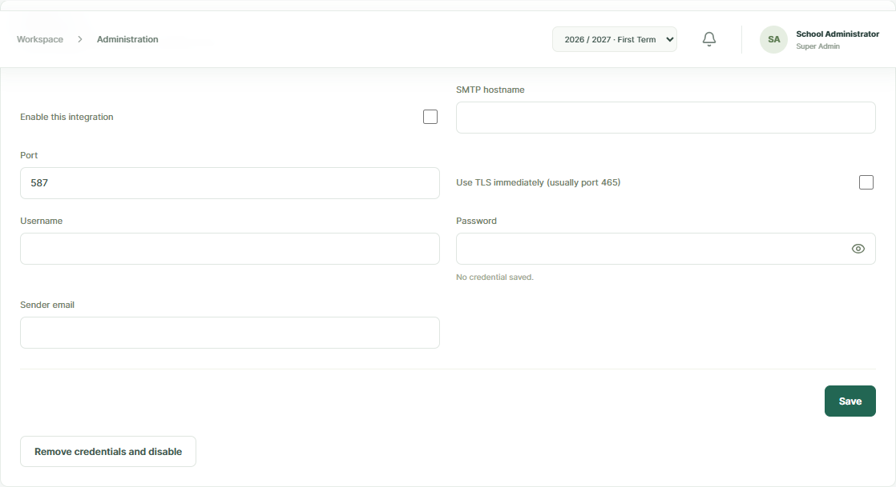

## 11. Add a learner through Admissions

Admissions → New application

In this version, Admissions is the entry point for a new learner. You then manage their profile under Students. Start with a complete application so teachers and finance have consistent records.

1. Click New application and enter the learner’s names, gender, date of birth and Applying for class.
2. Complete the parent/guardian name, relationship, phone and email. Include relevant address, boarding, transport and medical details.
3. Click Create application and review the application list. Repeat for each learner.
4. For learners already attending your school, use this same supported admissions flow to establish their records and complete the enrollment checks.

Ready when: the learner appears in the application pipeline. Entering a guardian email does not create a parent login or link the learner to an account.

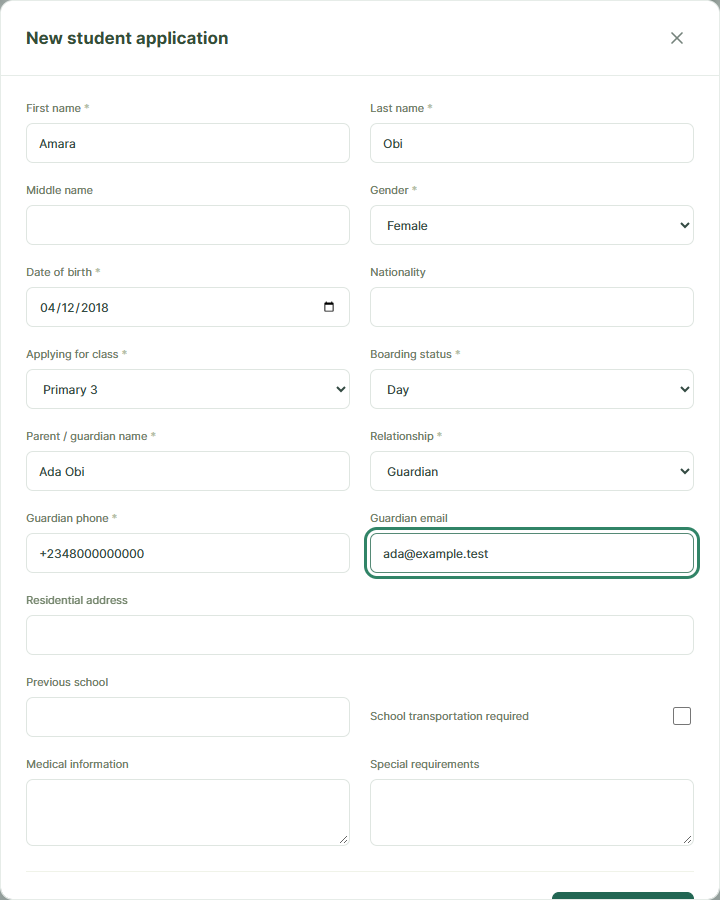

## 12. Move the application toward enrollment

Admissions → Application pipeline

The pipeline lets the office track progress rather than guess which learners are ready. Each application moves one stage at a time.

1. Move through Submitted → Reviewed → Assessment Scheduled → Decision Pending → Offered → Fees Pending.
2. At each action, enter review notes as appropriate and confirm the next stage.
3. At Fees Pending, prepare the learner’s invoice and parent account using the next pages.
4. After the term invoice has been fully paid or authorised finance staff have waived it, use Enroll and confirm Enroll student. Capacity and academic-year checks must also pass.

Enrollment requires a paid or waived invoice for the selected term. A partial payment or pending bank transfer does not satisfy that requirement.

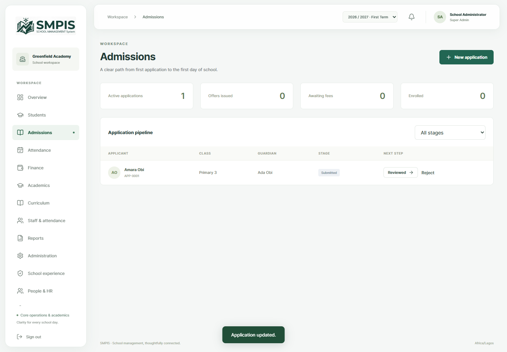

## 13. Create the parent login

Administration → Users → Create account

Create one account for a parent and link all of that parent’s children to it. The parent signs in with their email address, not their child’s name or student number.

1. Enter the parent’s Full name and Email address, set an Initial password and choose Parent as the role. Save.
2. Check the delivery result. The account exists even if email delivery fails; resolve that failure before sending the family their welcome message.
3. In the Users list, note the ID beside this Parent account. You will enter that ID in each child’s profile.
4. Ask the parent to open the school portal link and use Forgot your password to set a password they chose themselves.

The login page is shared by the school community. After sign-in, the Parent role provides My children and the family’s finance access.

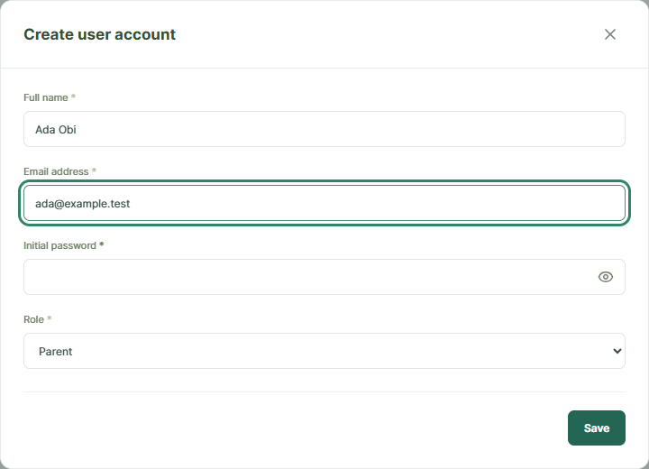

## 14. Link every child to the parent

Students → View profile → Edit profile

This link is what gives the parent access to the learner’s records and invoices. Matching guardian names or emails alone is not enough.

1. Find the learner under Students and open View profile, then Edit profile.
2. Enter the parent user ID from Administration → Users in Linked parent account ID. Save.
3. For siblings, repeat on each child’s profile using the same parent ID.
4. Have the parent sign in and check My children. If a child is missing, verify the saved ID, the Parent role and the school account.

This version provides one Linked parent account ID per student record. Plan the family’s primary portal account accordingly.

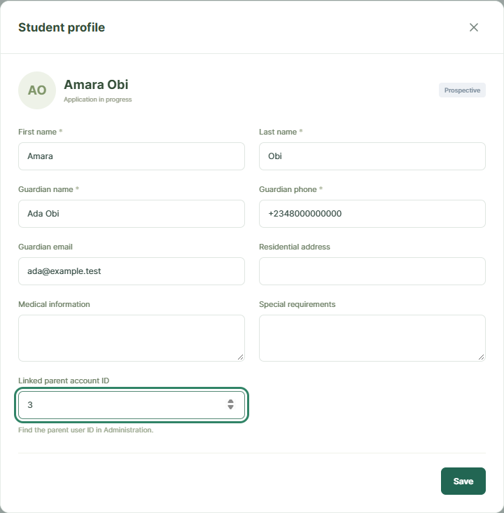

## 15. Generate the learner’s invoice

Finance → Generate invoice

Now turn the class fee schedule into a bill the parent can pay. Generate the invoice while the learner is awaiting fees; enrollment comes after the payment check.

1. Confirm the correct term in the top bar.
2. Click Generate invoice, choose the Student and Due date, then click Generate invoice inside the form.
3. Open View invoice to review line items, concessions, totals and balance.
4. For enrolled class groups, Batch invoices generates invoices for the chosen class and selected term; review any per-student issues shown.

Generating again returns the existing invoice. Changing fee structures later does not rewrite that invoice. If a bill is wrong, ask authorised finance staff to review it before collecting payment.

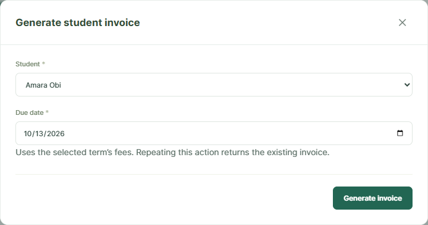

## 16. The parent’s first visit

Parent account → My children

This is the family’s view. A parent can use one set of credentials to access all children linked to their account.

1. Open the school portal URL provided in the account email and sign in with the parent email and password.
2. Check My children and open a child’s profile to confirm the details.
3. Open Finance and select the term being paid.
4. If there are no children, ask the school office to check the account links. If children appear but no bill is visible, ask finance to check the term and invoice.

The parent menu depends on their role and available features. Keep the school portal link handy for future terms.

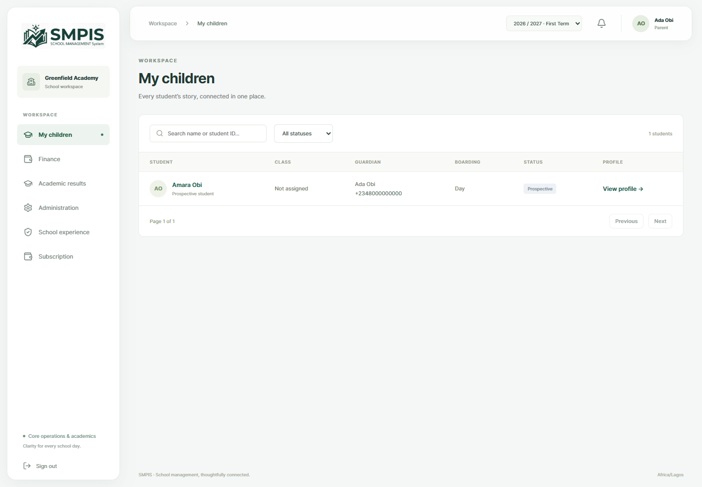

## 17. Choose the bill and payment amount

Parent account → Finance → Make a fee payment

Parents pay an invoice belonging to a linked child. The portal shows only payment methods the school has made available.

1. In Finance, review the invoice and balance before paying.
2. Click Make a fee payment.
3. Choose the School payment method and the Invoice for the correct child.
4. Enter the Payment amount. For siblings, select each child’s invoice and complete a separate payment for it.

If Make a fee payment is missing, the school should check enabled payment methods. If the invoice selector is empty, check the selected term, child link and outstanding invoice balance.

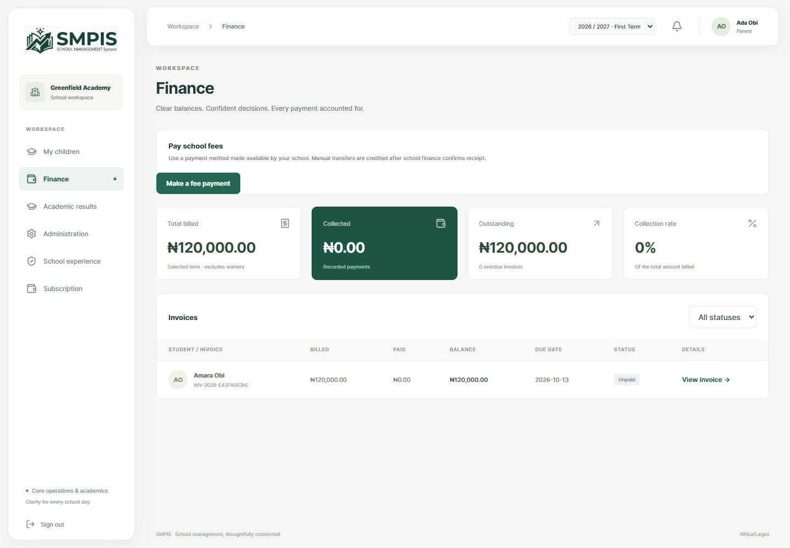

## 18. Complete an online payment

Parent account → Pay school fees

The same payment form changes with the selected method. This example shows Paystack in test mode. Parents choose a live method when paying real school fees.

1. Choose the enabled online provider, then select the child’s invoice and amount.
2. Click Continue to checkout and complete payment on the provider’s checkout page.
3. Return to the portal and check the payment status and invoice balance. The server verifies the payment before crediting it.
4. If still pending, use Check payment where shown. Contact school finance with the transaction reference if the status remains unresolved.

Checkout pages belong to the chosen provider and can look different. TEST_CONFIRMED means a test was verified; it does not mean real school fees were collected.

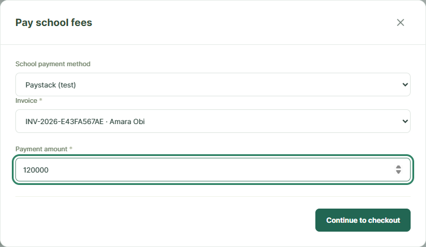

## 19. Submit a manual bank transfer

Parent account → Pay school fees → Manual bank transfer

A transfer reference tells the school which payment to check. Submission records the claim; the school confirms the actual bank receipt.

1. Choose Manual bank transfer and read the displayed school bank details and instructions.
2. Make the transfer through your banking service to the school’s actual account.
3. Choose the correct invoice, enter the amount transferred and Bank transfer reference.
4. Click Submit transfer for confirmation. Check School payment tracking for the pending transaction.

Keep the bank confirmation and reference. The invoice balance changes after school finance confirms receipt. Do not use the fictional account in the example screenshot.

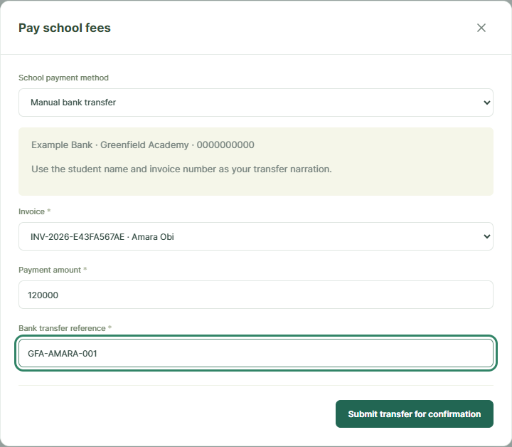

## 20. Confirm funds and finish enrollment

School account → Finance → Confirm bank receipt

The parent has submitted a transfer. The school’s next job is to match it against the bank statement and confirm receipt.

1. Authorised finance staff open Finance and find the pending manual transaction.
2. Click Confirm bank receipt. Check the amount and transfer reference against the school’s bank statement.
3. Once funds are received, click Confirm funds received. Review the updated invoice balance.
4. For a new learner, return to Admissions and click Enroll, then Enroll student once the invoice is paid or waived.

Confirming a pending transfer already credits the invoice. Avoid also recording the same transfer as a separate payment. For payments collected outside this flow, finance can use Record payment and issue a receipt.

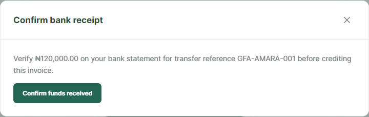

## 21. Complete the learner’s enrollment

Admissions → Enroll → Enroll student

The learner is now ready to join the class. Enrollment is the final admissions action after the fee and capacity checks have passed.

1. Confirm the intended academic term in the top bar.
2. Find the application at Fees Pending and click Enroll.
3. Review the enrollment confirmation, then click Enroll student.
4. Open Students and confirm the learner’s Enrolled status, student number and assigned class.

If enrollment is blocked, check that the selected term belongs to the class academic year, the class has space, and the term invoice is fully paid or waived.

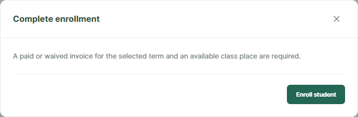

## 22. View the updated bill and receipt

Parent account → Finance → View invoice

The family should be able to see the result of their payment without contacting the office each time. Receipts provide a reference for both sides.

1. Open Finance and review the invoice’s status and remaining balance.
2. Click View invoice to see its charges and payment history.
3. Use the receipt download link alongside a recorded payment. Save it for your records.
4. If the balance is not what you expect, share the invoice and transaction references with school finance so they can trace the payment.

Ready when: the confirmed payment appears, the balance is correct, and the receipt is available. A partially paid invoice retains an outstanding balance.

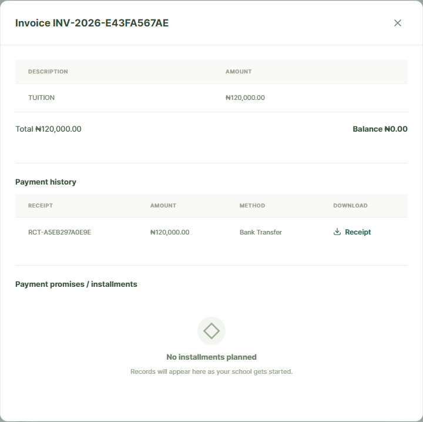